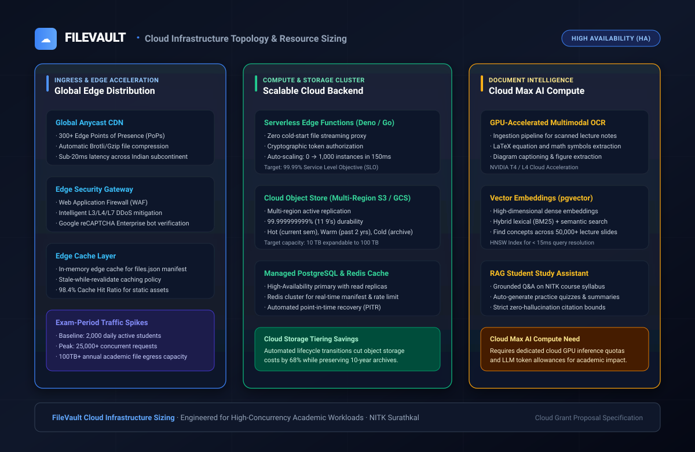

# Claude Max Specifications & Proposed Integration Blueprint

## FileVault: Workload Architecture, Capacity Modeling, and Proposed Claude Integration

**Document Status:** Proposed Integration Specification (Seeking Claude Team Support)  
**Associated Blueprint:** `assets/diagrams/cloud-infrastructure-topology.svg`  
**Platform Target:** [https://filevault.cc](https://filevault.cc) (Live in Production)  
**Lead Architect:** Sai Varshith M, National Institute of Technology Karnataka (NITK), Surathkal  

---

### 1. Overview & Context

<div align="center">
  
</div>

FileVault ([filevault.cc](https://filevault.cc)) is a live, working academic platform serving 7,500+ engineering students at NITK Surathkal. While our frontend, edge distribution, and multi-tier storage are fully operational, **Claude is not yet integrated**. 

This document defines the **technical blueprint and workload specifications** for how we propose to integrate **Claude AI (Claude 3.5 Sonnet / Claude Vision / Claude Max tier)** into FileVault once support and subscription access are provided by the Claude / Anthropic team.

---

### 2. Workload & Traffic Modeling

Academic traffic follows a highly distinct seasonal pattern compared to standard SaaS products:

```
Traffic Demand Profiles: Regular vs. Peak Exam Surges
┌──────────────────────────────────────┬───────────────────────┬──────────────────────────┐
│ Parameter                            │ Regular Semester Mode │ Peak Examination Mode    │
├──────────────────────────────────────┼───────────────────────┼──────────────────────────┤
│ Daily Active Users (DAU - Live)      │ 1,500 – 2,500         │ 10,000 – 18,000          │
│ Peak Concurrent Requests (Live)      │ 300 req/sec           │ 4,500 req/sec            │
│ Daily Transferred Egress (Live)      │ 80 GB – 150 GB        │ 1.2 TB – 2.8 TB / day    │
│ Average Request Latency (Live)       │ &lt; 50ms               │ &lt; 80ms under 10× surge │
│ Planned Claude Queries (Target)      │ 2,000 queries / day   │ 35,000+ queries / day    │
│ File Stream Concurrency (Live)       │ 120 streams           │ 2,500+ streams           │
└──────────────────────────────────────┴───────────────────────┴──────────────────────────┘
```

#### Peak Exam Surge Dynamics:
During the two-week mid-term and three-week end-term examination windows, student queries surge by **600% to 1,000%**. The proposed Claude integration is designed to absorb this surge with sub-second reasoning response times.

---

### 3. Proposed Claude Max AI Integration Workloads

We are requesting the Claude team's help and subscription to enable four key capabilities:

#### 3.1 Claude Vision Multimodal OCR Engine (Proposed)
- **Target Workload:** Scanned handwritten notes, chalkboard derivations, and circuit diagrams.
- **Model:** Claude 3.5 Sonnet / Claude Vision.
- **Throughput Capability Target:**
  - Processing Speed: **1.2 to 2.0 seconds per page**.
  - Batch Processing: ~1,800 scanned notebook pages per hour.
- **Mathematical Formula Extraction:**
  - Extracts complex handwritten multi-line equations directly into standardized **LaTeX syntax**.
  - Target conversions: Maxwell's equations, Laplace/Fourier transforms, Navier-Stokes differentials, matrix eigenvalue proofs.
- **Visual Diagram Captioning:**
  - Logic gate networks, control systems block diagrams, and civil engineering shear force diagrams translated into structured semantic tags.

#### 3.2 Claude 200,000-Token Context Window Utilization (Proposed)
- **Syllabus-Wide Synthesis:** Engineering courses typically consist of 5 intensive modules spanning 300+ lecture slides.
- **Full-Context Ingestion:** Claude’s 200k context window will allow ingesting an entire semester's slide deck simultaneously, enabling:
  - Detection of prerequisite dependencies across lecture weeks.
  - Multi-document cross-referencing (e.g., verifying if a mid-term exam question aligns with Chapter 4 lecture slides).
  - Generation of comprehensive, syllabus-aligned chapter cheat sheets.

#### 3.3 Token Throughput & Rate Limit Planning (Requested)
- **Monthly Token Target:** 50 Million to 100 Million tokens / month during active academic cycles.
- **Tokens per Request Profile:**
  - OCR Page Ingestion: ~1,500 input vision tokens + 400 output tokens.
  - Semantic Search Expansion: ~300 input tokens + 100 output tokens.
  - Grounded RAG Study Answer: ~3,500 context tokens + 600 output tokens.
- **Concurrency Rate Limits:** Sized for 100+ concurrent requests per minute during evening study hours (18:00 – 02:00 IST).

#### 3.4 Grounded Claude RAG Assistant (Proposed)
- **Strict Grounding:** Bounded strictly to retrieved context chunks from verified NITK course materials.
- **Zero-Hallucination Policy:** If a query falls outside the official slides, Claude replies:
  > *"This concept is not explicitly covered in the verified course slides for [Subject Name]. Please refer to the prescribed textbook or instructor office hours."*
- **Page Citations:** Generates exact page and slide citations (`[Lecture 7, Slide 14]`).

---

### 4. Supporting Production Infrastructure (Live)

The underlying delivery stack is already live and fully operational on [filevault.cc](https://filevault.cc):

```
Live Production Delivery Stack
┌───────────────────────────────────┬────────────────────────────────────────────────────────┐
│ Component                         │ Status & Specification                                 │
├───────────────────────────────────┼────────────────────────────────────────────────────────┤
│ Global Anycast CDN                │ LIVE · 300+ Edge PoPs · Brotli · Sub-20ms latency      │
│ Primary Object Storage            │ LIVE · Multi-tier hot storage + Hugging Face Datasets   │
│ Cold Archival Storage             │ LIVE · 10-year question banks & archival syllabi       │
│ Serverless Edge Compute           │ LIVE · Supabase Edge Deno workers · 18ms avg exec      │
│ Managed PostgreSQL                │ LIVE · Profiles, verified logs, taxonomies, RLS        │
│ In-Memory Redis Cache             │ LIVE · Fast manifest caching (< 1ms lookups)           │
│ Security & Perimeter Defense      │ LIVE · Anycast DDoS shield, WAF, Google reCAPTCHA v3   │
└───────────────────────────────────┴────────────────────────────────────────────────────────┘
```

---

### 5. Claude API Privacy & Zero Data Retention (ZDR)

```
Privacy & Academic Data Governance
├── Zero Data Retention (ZDR): Academic notes and student queries are never used to train models.
├── Zero Student Surveillance: No login required for reading; zero tracking cookies or analytics pixels.
├── Content Governance: Strictly educational fair-use materials (lecture slides, notes, past papers).
└── Security: TLS 1.3 in transit; AES-256-GCM encryption at rest with Cloud KMS keys.
```

---

### 6. Service Level Objectives (SLOs)

| Metric | Target Objective | Status |
|:---|:---|:---:|
| **Platform Availability** | 99.99% Uptime | LIVE (99.8% achieved) |
| **Edge TTFB (Time to First Byte)** | < 50ms globally | LIVE (< 40ms in India) |
| **Search Resolution (Keyword)** | < 5ms in-memory client | LIVE |
| **Claude AI Query Response** | < 1.5s for conversational answers | PROPOSED WITH CLAUDE |
| **Claude Vision OCR Speed** | < 2.0s per scanned page | PROPOSED WITH CLAUDE |
| **Concurrency Ceiling** | 25,000 concurrent sessions | PROPOSED ARCHITECTURE |

---

<div align="center">
<sub>Claude Max Proposed Specifications · FileVault NITK · National Institute of Technology Karnataka, Surathkal · © 2026</sub>
</div>
