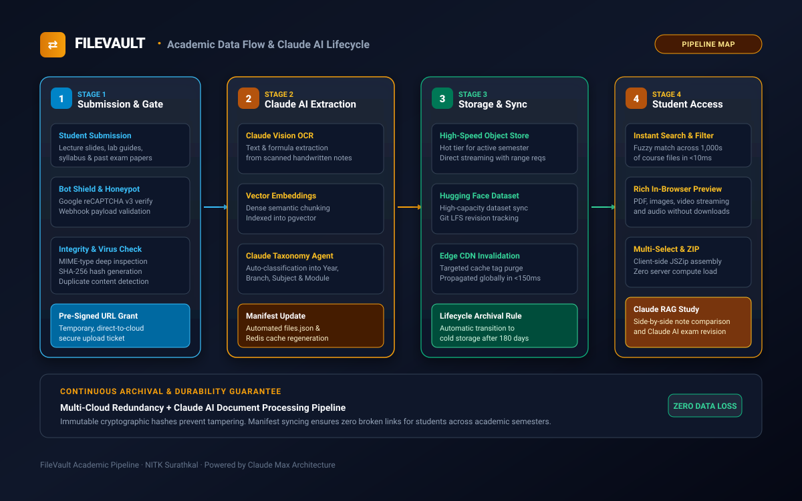

# Academic Data Pipeline & Lifecycle Specification

## FileVault: Data Ingestion, Processing, Distribution, and Retrieval Architecture

**Status:** Technical Specification  
**Associated Diagram:** `assets/diagrams/data-flow-pipeline.svg`  
**Platform Target:** [https://filevault.cc](https://filevault.cc)  
**Author:** Sai Varshith M, National Institute of Technology Karnataka (NITK), Surathkal  

---

### 1. Architectural Data Lifecycle Overview

<div align="center">
  
</div>

Delivering thousands of high-fidelity academic files to engineering students with zero latency requires a synchronized data pipeline. This document defines the **4-stage lifecycle** of an academic resource within FileVault—from initial student or faculty submission to global edge delivery.

---

### 2. Stage 1: Submission & Ingestion Gateway

```
Stage 1: Ingestion Gateway Flow
┌──────────────────┐     ┌──────────────────┐     ┌──────────────────┐
│ Student Resource │ ──► │ Google reCAPTCHA │ ──► │ File Integrity   │
│ Share Request    │     │ Behavioral Risk  │     │ & MIME Validation│
└──────────────────┘     └──────────────────┘     └────────┬─────────┘
                                                           │
                                                           ▼
┌──────────────────┐     ┌──────────────────┐     ┌──────────────────┐
│ Direct Cloud     │ ◄── │ Pre-Signed URL   │ ◄── │ SHA-256 Hash &   │
│ Stream Upload    │     │ Temporary Ticket │     │ Duplicate Check  │
└──────────────────┘     └──────────────────┘     └──────────────────┘
```

#### 2.1 Contribution Submission Interface
- Academic resources (lecture slides, handwritten study guides, lab records, syllabus copies) are submitted through the contribution portal on [filevault.cc](https://filevault.cc).
- Forms capture: Submitter Name, Academic Year (1st through 4th Year / Postgrad), Department/Branch, Subject Code, Course Name, and Resource File.

#### 2.2 Bot Defense & Ingestion Security
- Submissions trigger a background **Google reCAPTCHA v3** token assessment. Submissions with risk scores below `0.5` are rejected automatically to prevent automated spam and server flooding.
- Submissions are logged asynchronously to a secure Google Sheets webhook (`WEBHOOK_URL`) for review, verification, and audit tracking.

#### 2.3 File Integrity & Deep MIME Inspection
- Uploaded files undergo deep magic-byte inspection to verify that MIME types match file extensions (preventing disguised executables or malicious payloads).
- Permitted MIME types:
  - Documents: `application/pdf`, `text/plain`, `text/markdown`, `application/zip`
  - Code: `text/x-c`, `text/x-c++`, `text/x-python`, `text/x-java`, `application/x-matlab`
  - Media: `image/png`, `image/jpeg`, `image/svg+xml`, `video/mp4`, `audio/mpeg`

#### 2.4 Cryptographic Hashing & Direct-to-Cloud Pre-Signed Uploads
- A **SHA-256 cryptographic checksum** is generated for every ingested file.
- Rather than piping heavy multi-gigabyte files through the web server, the API generates a **pre-signed cloud upload URL** with an expiration window of 900 seconds.
- The client browser streams the binary payload directly into the Cloud Object Store bucket (`PUT /objects/{hash}`), offloading heavy network I/O from the application server.

---

### 3. Stage 2: Claude AI Processing & Intelligence (Claude Max)

Detailed processing and throughput limits are governed by the **[Claude Max Specifications](CLAUDE_MAX_SPECIFICATIONS.md)**.

Once files are stored in the staging bucket, background workers execute the Claude document intelligence pipeline:

```
Stage 2: Claude AI Extraction Pipeline
┌──────────────────┐     ┌──────────────────┐     ┌──────────────────┐
│ Staged Document  │ ──► │ Claude Vision    │ ──► │ Formula Parsing  │
│ (Scanned/PDF)    │     │ Multimodal OCR   │     │ & Schema Tokenize│
└──────────────────┘     └──────────────────┘     └────────┬─────────┘
                                                           │
                                                           ▼
┌──────────────────┐     ┌──────────────────┐     ┌──────────────────┐
│ Updated Global   │ ◄── │ HNSW Vector      │ ◄── │ 1536-dim Dense   │
│ files.json Cache │     │ Indexing         │     │ Text Embeddings  │
└──────────────────┘     └──────────────────┘     └──────────────────┘
```

#### 3.1 Claude Vision Multimodal OCR Engine
- Scanned handwritten notes (which represent over 40% of student-shared materials) are notoriously difficult for standard text search.
- Claude 3.5 Sonnet / Claude Vision processes these pages, extracting:
  - Handwritten mathematical derivations into standardized **LaTeX syntax**.
  - Block diagrams, state machines, and electronic circuit topologies into descriptive semantic tags.
  - Handwritten notes into clean, structured Markdown.
- Sizing specifications: **[Claude Max Specifications](CLAUDE_MAX_SPECIFICATIONS.md)**.


#### 3.2 Semantic Chunking & Vector Embeddings
- Extracted text and slide transcripts are segmented into semantically coherent chunks (500 tokens with 50-token overlap).
- High-dimensional dense embeddings (1536 dimensions) are generated for each chunk.
- Embeddings are written to the `pgvector` store in PostgreSQL, indexed with an **HNSW graph** for sub-15ms vector retrieval.

#### 3.3 Automated Taxonomy & Deduplication
- Perceptual image hashing (`pHash`) and SHA-256 matching detect duplicate uploads across different semesters.
- Natural Language Classifiers automatically categorize the file into its proper branch hierarchy:
  `Department / Academic Year / Semester / Subject Code / Module / Document Type`

---

### 4. Stage 3: Storage & Global Synchronization

```
Stage 3: Multi-Cloud Replication & Edge Propagation
┌─────────────────────────┐      ┌─────────────────────────┐
│ Primary Cloud Object    │ ───► │ Hugging Face Datasets   │
│ Store (S3 / GCS)        │      │ Git LFS High-Cap Mirror │
└───────────┬─────────────┘      └─────────────────────────┘
            │
            ▼
┌─────────────────────────┐      ┌─────────────────────────┐
│ Global CDN Edge Purge   │ ───► │ In-Memory Redis Cluster │
│ Targeted Cache Tags     │      │ Sub-ms Manifest Lookups │
└─────────────────────────┘      └─────────────────────────┘
```

#### 4.1 Multi-Cloud Redundancy
- High-capacity datasets and large laboratory archives are synced to the Hugging Face Hub Dataset backend (`saivarshithm/file-vault-assets`) using automated Python synchronization scripts (`scripts/sync_hf_manifest.py`).
- This multi-cloud architecture guarantees that academic materials remain 100% accessible even in the event of upstream outages or regional connectivity disruptions.

#### 4.2 Automated Manifest Generation (`files.json`)
- The single source of truth for all accessible courseware is the CI-compiled `files.json` manifest.
- Whenever new materials are approved, GitHub Actions CI or serverless workers regenerate the manifest, calculate size attributes, and compress it with Brotli.
- Changes are deployed automatically within **30 seconds**.

#### 4.3 Targeted Cache Invalidation
- The CDN edge network utilizes **Surrogate-Key / Cache-Tag** invalidation. When a specific subject's notes are updated, only that subject's cache tag is invalidated globally—avoiding expensive full-site cache purges.

---

### 5. Stage 4: Student Retrieval & Client-Side Acceleration

```
Stage 4: Student Retrieval Experience
┌──────────────────────────────────────┬───────────────────────────────────┐
│ Client Interaction                   │ Performance Guarantee             │
├──────────────────────────────────────┼───────────────────────────────────┤
│ Instant Keyword Search               │ &lt; 5ms in-memory client filtering   │
│ Semantic Concept Search              │ &lt; 50ms HNSW vector resolution     │
│ Document Preview (PDF / Video)       │ Sub-100ms byte-range streaming    │
│ Multi-Select Batch Download (JSZip)  │ 100% client-side Web Worker       │
│ Side-by-Side Dual Resource Compare   │ Zero-reload split-view canvas     │
└──────────────────────────────────────┴───────────────────────────────────┘
```

#### 5.1 In-Memory Fuzzy Search Engine
- When a student loads [filevault.cc](https://filevault.cc), the compressed manifest is stored in local browser memory.
- Instant search filters thousands of files across all years and departments simultaneously as the user types, with zero network latency.

#### 5.2 HTTP Byte-Range Streaming
- Large lecture recordings (MP4/WebM) and 300-page textbook PDFs are streamed using HTTP `Range: bytes=0-1048575` headers.
- Students view the first page in under **80ms**, while subsequent pages are fetched on-demand as the user scrolls.

#### 5.3 Client-Side ZIP Assembly (`JSZip`)
- To batch download course modules, the browser spawns a dedicated Web Worker that pulls byte chunks concurrently from edge storage and compiles a compressed ZIP container in client memory.
- **Result:** No server compute load; zero latency waiting for server-side archive preparation; limitless concurrent downloads during exam preparation.

---

<div align="center">
<sub>FileVault Data Lifecycle Specification · National Institute of Technology Karnataka (NITK), Surathkal · © 2026</sub>
</div>

