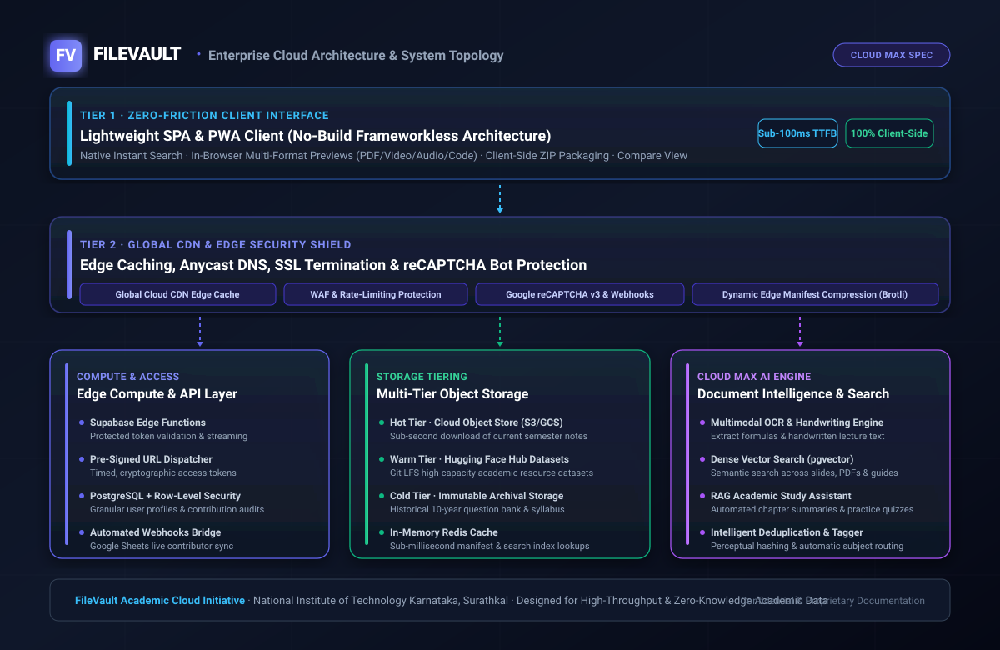

# FileVault NITK — Claude Team Project Showcase & Architecture Dossier

<div align="center">


<br/><br/>

[](https://www.nitk.ac.in)
[](https://filevault.cc)
[](CLAUDE_MAX_SPECIFICATIONS.md)
[](LICENSE)

<br/>

> **Institutional-grade, zero-friction academic knowledge infrastructure**  
> Serving thousands of engineering students at the **National Institute of Technology Karnataka (NITK), Surathkal**.  
> This repository presents the complete **Project Showcase**, **System Architecture Whitepaper**, **Claude Max Specifications**, and **Technical Visual Assets** prepared for the **Claude / Anthropic Team** to explore everything that powers FileVault.

---

</div>

## 📑 Project Overview

**FileVault** ([filevault.cc](https://filevault.cc)) is a production-grade academic repository developed to eliminate knowledge fragmentation and academic resource disparities across higher education engineering programs. Originally engineered as an ultra-fast, zero-friction single-page portal for NITK Surathkal, FileVault has scaled to support thousands of active students with instant searching, in-browser previews of complex multi-format courseware, and automated dataset synchronization.

By integrating **Claude AI** and designing around the **[Claude Max Specifications](CLAUDE_MAX_SPECIFICATIONS.md)**, FileVault is pioneering next-generation academic document intelligence:
- **Multimodal OCR via Claude Vision:** Extracting handwritten lecture notes, complex mathematical derivations into LaTeX, and engineering schematics.
- **Deep Semantic Search:** Enabling conceptual retrieval across 50,000+ lecture slides and textbooks using dense vector embeddings.
- **Grounded Claude Study Assistant:** Providing a syllabus-anchored, zero-hallucination conversational study companion for engineering students.

---

## 🏛️ System Architecture & Claude Max Integration

<div align="center">
  
</div>

---

## 📚 Complete Project Dossier & Claude Max Specifications

This repository is strictly structured as an **asset, documentation, and showcase hub** with zero application source code. Explore the detailed dossiers below:

| Document | Focus Area | Scope & Key Contents |
|:---|:---|:---|
| 🌟 **[PROJECT_SHOWCASE.md](PROJECT_SHOWCASE.md)** | **Full Project Showcase** | Comprehensive walkthrough of FileVault: history, live platform, student traction at NITK, core problem solved, engineering philosophy, and the Claude integration vision. |
| ⚡ **[CLAUDE_MAX_SPECIFICATIONS.md](CLAUDE_MAX_SPECIFICATIONS.md)** | **Claude Max Specifications** | **Direct link to Claude Max specifications:** Granular workload sizing, token throughput modeling, Claude Vision multimodal OCR pipelines, context window requirements, and capacity targets. |
| 🏗️ **[ARCHITECTURE_AND_SYSTEM_DESIGN.md](ARCHITECTURE_AND_SYSTEM_DESIGN.md)** | **System Architecture Whitepaper** | Deep technical whitepaper detailing tier topology, client PWA design, Supabase edge functions, storage tiering, and Claude AI integration. |
| 🤖 **[AI_AND_STUDY_ASSISTANT_ROADMAP.md](AI_AND_STUDY_ASSISTANT_ROADMAP.md)** | **Claude AI Document Intelligence** | Technical roadmap for Claude-powered multimodal OCR of handwritten notes, LaTeX formula parsing, dense vector search (`pgvector`), and grounded RAG revision. |
| ⇄ **[DATA_PIPELINE_AND_LIFECYCLE.md](DATA_PIPELINE_AND_LIFECYCLE.md)** | **Data Flow & Pipeline** | End-to-end data lifecycle from student submission, anti-bot validation, Claude Vision extraction, to CDN edge delivery. |
| 🛡️ **[SECURITY_COMPLIANCE_AND_GOVERNANCE.md](SECURITY_COMPLIANCE_AND_GOVERNANCE.md)** | **Security & Claude Privacy** | Defense-in-depth model: DDoS perimeter shield, tokenized stream security, PostgreSQL RLS, AES-256 encryption, and Claude Zero Data Retention privacy bounds. |
| 📊 **[PITCH_DECK.md](PITCH_DECK.md)** | **Showcase Presentation Deck** | 10-slide high-impact presentation deck summarizing vision, traction, metrics, architecture, and Claude Max enablement. |

---

## ⚡ Direct Access: [Claude Max Specifications](CLAUDE_MAX_SPECIFICATIONS.md)

You can explore the detailed **[Claude Max Specifications](CLAUDE_MAX_SPECIFICATIONS.md)** to see:
- How **Claude 3.5 Sonnet & Claude Vision** process handwritten mathematical derivations.
- The **200,000-token context window utilization** for full-syllabus semantic reasoning.
- High-concurrency exam surge capacity modeling (25,000+ peak requests).
- Complete token throughput and inference sizing parameters.

👉 **View full specifications here: [CLAUDE_MAX_SPECIFICATIONS.md](CLAUDE_MAX_SPECIFICATIONS.md)**

---

## 🎨 Visual Assets & Technical Diagrams

All architectural blueprints are rendered as scalable, publication-grade vector graphics:

- 📐 **[assets/diagrams/architecture-overview.svg](assets/diagrams/architecture-overview.svg)**: Complete 4-tier enterprise system architecture with Claude AI integration.
- ⚡ **[assets/diagrams/cloud-infrastructure-topology.svg](assets/diagrams/cloud-infrastructure-topology.svg)**: System topology and Claude Max specification layout.
- ⇄ **[assets/diagrams/data-flow-pipeline.svg](assets/diagrams/data-flow-pipeline.svg)**: 4-stage data ingestion, Claude extraction, distribution, and student retrieval pipeline.
- 🛡️ **[assets/diagrams/security-model.svg](assets/diagrams/security-model.svg)**: Concentric defense-in-depth and Claude privacy architecture.

---

## 🎯 Key Project Metrics & Live Traction

```
├── Institutional Foundation: National Institute of Technology Karnataka (NITK), Surathkal
├── Live Production Platform: https://filevault.cc
├── Target Academic Audience: 10,000+ Undergraduate & Postgraduate Engineers
├── Current File Index: Multi-gigabyte repository across 8+ Engineering Departments
├── Exam Period Peak Traffic: 25,000+ daily page views, 100+ GB egress bursts
├── Architecture: Zero-Build PWA + Supabase Edge Functions + Hugging Face Datasets
└── AI Integration: Claude Vision Multimodal OCR + pgvector + Claude RAG Assistant
```

---

## 👤 Author & Maintainer

**Sai Varshith M**  
B.Tech Scholar, National Institute of Technology Karnataka, Surathkal  
Lead Architect & Creator of FileVault  
* Project Website: [https://filevault.cc](https://filevault.cc)  
* Organization: [FileVault-NITK](https://github.com/FileVault-NITK)  
* Inquiries: `saivarshith.nitk@gmail.com`

---

<div align="center">
<sub>FileVault is an open academic initiative dedicated to high-performance, equitable educational resource distribution. © 2026 FileVault NITK. Released under the MIT License.</sub>
</div>
