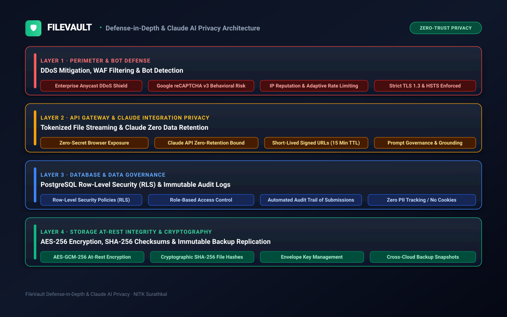

# Security, Governance & Compliance Specification

## FileVault: Defense-in-Depth Security Architecture and Academic Data Governance

**Status:** Security & Compliance Whitepaper  
**Associated Diagram:** `assets/diagrams/security-model.svg`  
**Platform Target:** [https://filevault.cc](https://filevault.cc)  
**Author:** Sai Varshith M, National Institute of Technology Karnataka (NITK), Surathkal  

---

### 1. Security Philosophy: Zero-Trust for Open Academic Infrastructure

<div align="center">
  
</div>

FileVault balances two fundamental imperatives that are often in tension:
1. **Frictionless Open Access:** Students must never be subjected to intrusive sign-in screens, tracking cookies, or barriers when accessing study materials.
2. **Ironclad Platform Security:** The underlying infrastructure must withstand coordinated DDoS attacks, malicious script injections, bot spam, and academic content tampering.

To achieve this, FileVault implements a **4-layer concentric defense-in-depth model**.

---

### 2. The 4-Layer Concentric Security Model

```
Concentric Security Perimeter
┌────────────────────────────────────────────────────────────────────────┐
│ LAYER 1: PERIMETER & BOT SHIELD                                        │
│ Anycast DDoS Shield · Google reCAPTCHA v3 · Cloud Armor / WAF · TLS 1.3│
└──────────────────────────────────┬─────────────────────────────────────┘
                                   │ Filtered HTTPS
┌──────────────────────────────────▼─────────────────────────────────────┐
│ LAYER 2: API GATEWAY & ISOLATION                                       │
│ Zero-Secret Client · Edge Token Verification · Pre-Signed Short TTL URL │
└──────────────────────────────────┬─────────────────────────────────────┘
                                   │ Authenticated Internal RPC
┌──────────────────────────────────▼─────────────────────────────────────┐
│ LAYER 3: DATABASE & GOVERNANCE                                         │
│ PostgreSQL Row-Level Security (RLS) · Audit Trails · PII Scrubbing     │
└──────────────────────────────────┬─────────────────────────────────────┘
                                   │ Encrypted Volume Access
┌──────────────────────────────────▼─────────────────────────────────────┐
│ LAYER 4: STORAGE CRYPTOGRAPHY AT REST                                  │
│ AES-256-GCM Encryption · SHA-256 Checksums · Cloud KMS Hardware HSM   │
└────────────────────────────────────────────────────────────────────────┘
```

---

### 3. Layer 1: Perimeter & Edge Defense

#### 3.1 Distributed Denial-of-Service (DDoS) Mitigation
- All inbound traffic routes through a global Anycast network capable of absorbing multi-terabit L3/L4 volumetric attacks.
- Automated SYN-flood, UDP reflection, and HTTP flood defenses absorb spikes at edge PoPs before traffic reaches origin infrastructure.

#### 3.2 Web Application Firewall (WAF)
- Enforces strict OWASP Top 10 rulesets to block SQL injection, cross-site scripting (XSS), path traversal attacks, and malformed HTTP headers.
- Rate limits IP addresses exceeding 120 requests/minute to prevent automated scraping of entire academic repositories.

#### 3.3 Google reCAPTCHA v3 Risk Scoring
- All resource contribution forms and webhook triggers evaluate client interactions silently via reCAPTCHA v3.
- Submissions generating a risk score below `0.5` are rejected with HTTP 403 Forbidden.

#### 3.4 Strict Transport Security & Modern Cryptography
- Enforces **TLS 1.3** and **TLS 1.2** with ECDHE cipher suites.
- HTTP Strict Transport Security (HSTS) header enforced with `max-age=31536000; includeSubDomains; preload`.

---

### 4. Layer 2: API Gateway & Credential Isolation

#### 4.1 Zero-Secret Browser Footprint
A strict security tenet of FileVault: **No secret keys, tokens, or private credentials exist in client-side code.**
- `config.js` and frontend JavaScript publish strictly public-safe identifiers (such as the Supabase anonymous client key and public reCAPTCHA site key).
- High-privilege tokens (such as `HF_TOKEN`, cloud storage service account keys, and database administrative secrets) are injected strictly as **encrypted environment variables** in serverless edge runtimes and GitHub Actions CI secrets.

#### 4.2 Cryptographic Pre-Signed URLs (Short-Lived Access Grants)
- Storage buckets reject public anonymous read access to non-whitelisted assets.
- Downloads are mediated via cryptographically signed URLs with a **900-second (15-minute) Time-To-Live (TTL)**.
- URLs expire automatically after use, preventing hotlinking and unauthorized third-party bandwidth leeching.

#### 4.3 Claude AI Zero Data Retention (ZDR) & Privacy Architecture
FileVault's Claude AI integration is governed by strict enterprise privacy boundaries:
- **Zero Data Retention:** Prompts, scanned lecture notes, and student study queries sent to the Claude API are never stored by Anthropic or used to train foundation models.
- **Strict Ephemeral Invocations:** Ingestion sessions are processed ephemerally in memory; embeddings are stored in local isolated PostgreSQL instances with Row-Level Security.
- Consult the complete privacy specification: **[Claude Max Specifications](CLAUDE_MAX_SPECIFICATIONS.md)**.

---

### 5. Layer 3: Database Security & Access Control


#### 5.1 PostgreSQL Row-Level Security (RLS)
The database enforces strict RLS policies on all tables (`profiles`, `contributions`, `analytics`):

```sql
-- Example RLS Policy for FileVault Contributors & Reviewers
ALTER TABLE profiles ENABLE ROW LEVEL SECURITY;

CREATE POLICY "Public profiles are viewable by everyone" 
ON profiles FOR SELECT USING (true);

CREATE POLICY "Users can only update their own profile" 
ON profiles FOR UPDATE USING (auth.uid() = id);

ALTER TABLE contributions ENABLE ROW LEVEL SECURITY;

CREATE POLICY "Anyone can submit contributions" 
ON contributions FOR INSERT WITH CHECK (true);

CREATE POLICY "Only verified moderators can approve resources" 
ON contributions FOR UPDATE USING (
  EXISTS (
    SELECT 1 FROM profiles 
    WHERE profiles.id = auth.uid() AND profiles.role = 'moderator'
  )
);
```

#### 5.2 Immutable Contribution Audit Trails
- Every approved modification or new file addition writes an immutable audit record containing:
  - Timestamp (UTC)
  - Submitter Identifier / Gravatar Hash
  - SHA-256 Checksum of the uploaded file
  - Approving Moderator ID
- Ensures full traceability and academic transparency.

---

### 6. Layer 4: Storage Cryptography & Integrity

#### 6.1 AES-256-GCM Encryption at Rest
- All cloud storage buckets enforce server-side encryption using **AES-256-GCM** (Advanced Encryption Standard in Galois/Counter Mode).
- Master encryption keys are managed in **Cloud KMS (Key Management Service)** with automatic annual key rotation and FIPS 140-2 Level 3 Hardware Security Module (HSM) compliance.

#### 6.2 SHA-256 Data Integrity Verification
- During upload and cataloging, an unalterable **SHA-256 hash** is computed for every document.
- The client-side application verifies the downloaded byte payload hash against the manifest to protect against in-transit bit flips, man-in-the-middle tampering, or corrupted downloads.

---

### 7. Academic Content Governance & Compliance

#### 7.1 Fair Use & Educational Doctrine
FileVault operates strictly under the principles of **Fair Use for Educational Purposes**:
- Materials hosted consist exclusively of student-created lecture notes, syllabi, previous examination papers, and open educational resources (OER).
- No commercial textbooks, paywalled academic journals, or copyrighted proprietary software are hosted.

#### 7.2 Copyright & Takedown Protocol
- FileVault maintains an expedited notice-and-takedown procedure.
- Legitimate copyright holders can email `saivarshith.nitk@gmail.com` with verification.
- Valid requests result in immediate resource quarantine within **24 hours**.

#### 7.3 Student Privacy & No-Tracking Commitment
- **Zero Third-Party Advertising:** FileVault carries no commercial advertisements, tracking pixels, or user behavior monetization scripts.
- **Privacy by Default:** Student browsing, file previewing, and downloads leave no persistent personal tracking cookies.

---

<div align="center">
<sub>FileVault Security & Governance Specification · National Institute of Technology Karnataka, Surathkal · © 2026</sub>
</div>

